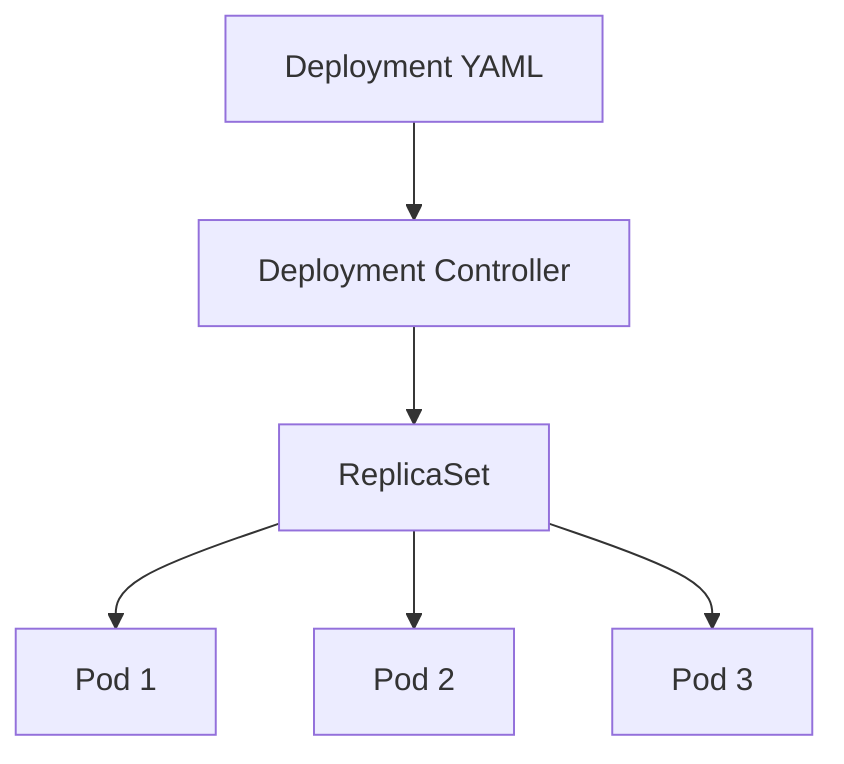
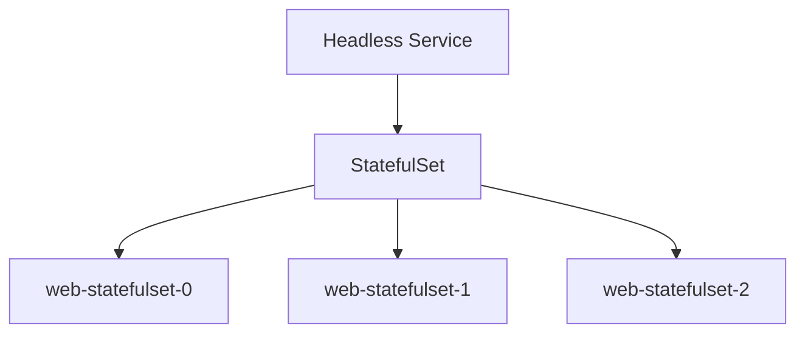
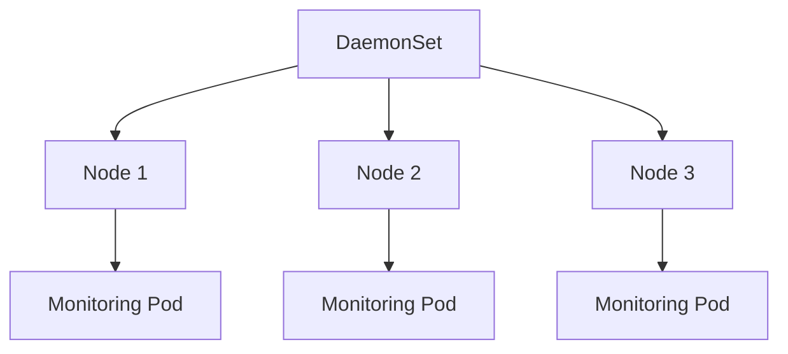
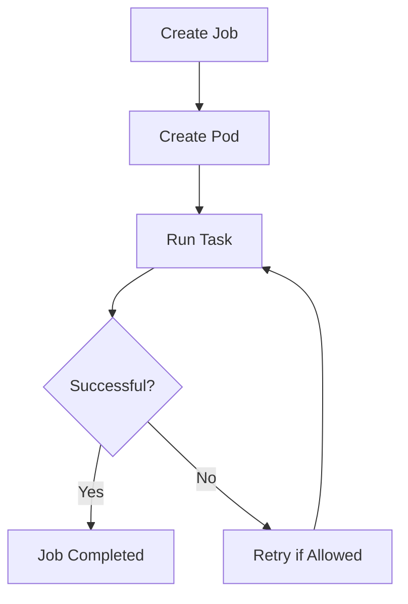
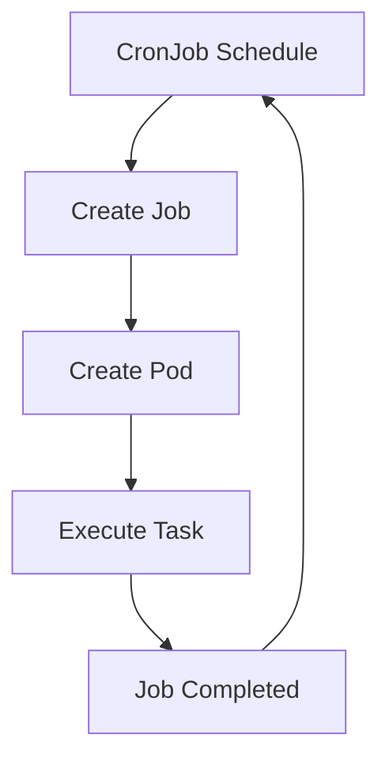

# Part 1: Kubernetes Workloads

## 1. Objective

Learn how Kubernetes runs applications and manages tasks using Deployments, StatefulSets, DaemonSets, Jobs, and CronJobs.

## 2. Prerequisites

- Kubernetes cluster running on Minikube.
- `kubectl` installed.
- Namespace: `production-labs`.
- Current kubectl context set to the `production-labs` namespace.

Check the cluster:

```bash
minikube status
kubectl get nodes
kubectl config view --minify | grep namespace
```

## 3. Deployment

### Definition

A Deployment manages application Pods and maintains the desired number of replicas.

### Flowchart



### File

`deployment.yaml`

### Execute

```bash
kubectl apply -f deployment.yaml
```

### Verify

```bash
kubectl get deployments
kubectl get replicasets
kubectl get pods -o wide
kubectl describe deployment web-deployment
```

Expected result: Three Pods should be running.

### Test self-healing

Delete one Pod using its actual name:

```bash
kubectl delete pod <pod-name>
kubectl get pods
```

Kubernetes creates a replacement Pod to maintain three replicas.

### Cleanup

```bash
kubectl delete -f deployment.yaml
```

---

## 4. StatefulSet

### Definition

A StatefulSet manages Pods that need a stable identity and can use persistent storage to keep their data.

### Flowchart



### Files

- `headless-service.yaml`
- `statefulset.yaml`

### Execute

Create the Headless Service first:

```bash
kubectl apply -f headless-service.yaml
kubectl apply -f statefulset.yaml
```

### Verify

```bash
kubectl get services
kubectl get statefulsets
kubectl get pods -o wide
```

Expected Pod names:

- `web-statefulset-0`
- `web-statefulset-1`
- `web-statefulset-2`

### Test stable identity

```bash
kubectl delete pod web-statefulset-1
kubectl get pods -w
```

The StatefulSet should recreate the Pod with the same name. Press `Ctrl+C` to stop watching.

Note: This exercise tests stable Pod identity. Persistent data storage will be covered in the storage section.

### Cleanup

```bash
kubectl delete -f statefulset.yaml
kubectl delete -f headless-service.yaml
```

---

## 5. DaemonSet

### Definition

A DaemonSet runs a Pod on each eligible node in the Kubernetes cluster.

### Flowchart



### File

`daemonset.yaml`

### Execute

```bash
kubectl apply -f daemonset.yaml
```

### Verify

```bash
kubectl get daemonsets
kubectl get pods -o wide
kubectl logs -l app=node-monitor
```

On a single-node cluster, one Pod is expected on the eligible node.

On a multinode cluster, the DaemonSet normally creates one Pod per eligible node.

### Cleanup

```bash
kubectl delete -f daemonset.yaml
```

---

## 6. Job

### Definition

A Job runs a task until it completes successfully.

### Flowchart



### File

`job.yaml`

### Execute

```bash
kubectl apply -f job.yaml
```

### Verify

```bash
kubectl get jobs
kubectl get pods
kubectl logs job/hello-job
```

Expected output:

```text
Hello from Kubernetes Job
```

The Job should eventually show one successful completion.

### Cleanup

```bash
kubectl delete -f job.yaml
```

---

## 7. CronJob

### Definition

A CronJob runs a task automatically on a schedule.

### Flowchart



### File

`cronjob.yaml`

### Execute

```bash
kubectl apply -f cronjob.yaml
```

### Verify

```bash
kubectl get cronjobs
kubectl get jobs
kubectl get pods
```

The example schedule runs every minute. Wait for a Job to be created.

Find the generated Job name:

```bash
kubectl get jobs
```

View its logs, replacing `<job-name>` with the actual name:

```bash
kubectl logs job/<job-name>
```

Expected output includes:

```text
Hello from Kubernetes CronJob
```

### Cleanup

```bash
kubectl delete -f cronjob.yaml
```

Delete the CronJob after testing so it does not keep creating Jobs every minute.

---

## 8. Troubleshooting Commands

Use these commands when a workload does not behave as expected.

### Check resources

```bash
kubectl get deployments
kubectl get statefulsets
kubectl get daemonsets
kubectl get jobs
kubectl get cronjobs
kubectl get pods -o wide
```

### Check Pod details

```bash
kubectl describe pod <pod-name>
```

### Check logs

```bash
kubectl logs <pod-name>
```

### Check recent events

```bash
kubectl get events --sort-by=.metadata.creationTimestamp
```

### Common problems

| Problem | What to check |
|---|---|
| Pod is Pending | Node resources, scheduling rules and events |
| ImagePullBackOff | Image name, tag and image access |
| CrashLoopBackOff | Container logs and startup command |
| Job fails | Job status, Pod logs and events |
| CronJob does not create a Job | Schedule, suspension and recent events |
| StatefulSet Pod is not ready | Headless Service, Pod status and events |

---

## 9. Cleanup

Delete the practice resources using the cleanup commands in their respective sections.

Check that the workload resources are gone:

```bash
kubectl get deployments
kubectl get statefulsets
kubectl get daemonsets
kubectl get jobs
kubectl get cronjobs
kubectl get pods
kubectl get services
```

Do not delete the `production-labs` namespace because it will be reused for the next project parts.

---

## 10. What We Learned

- Deployment maintains the desired number of application replicas.
- StatefulSet provides stable Pod names and identities.
- DaemonSet runs a Pod on each eligible node.
- Job runs a task until it completes successfully.
- CronJob schedules Jobs to run automatically.

## 11. Project Environment

- Cluster: Minikube
- Namespace: `production-labs`
- Project: Kubernetes Production Labs
- Part: 1 — Workloads


