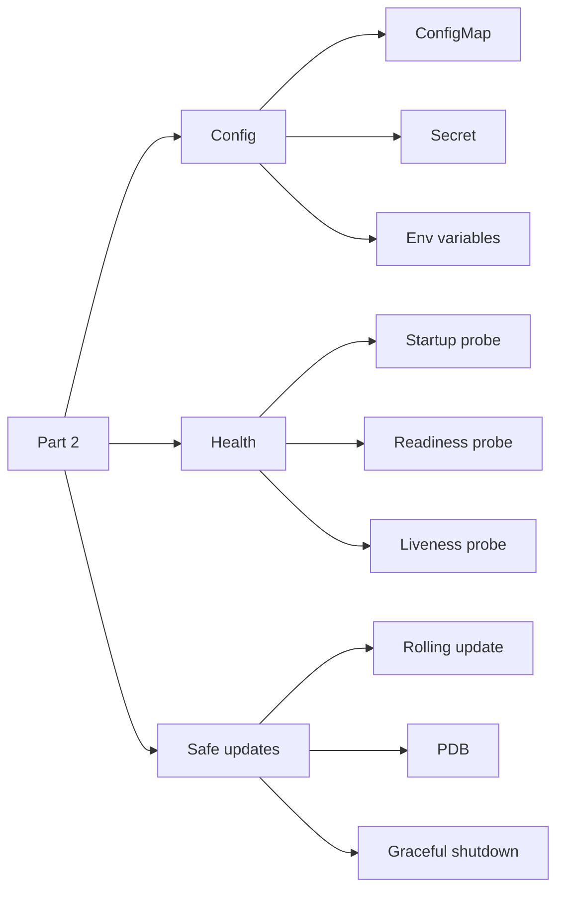
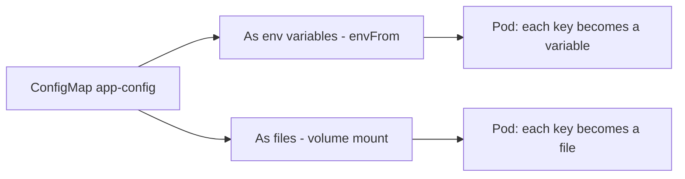
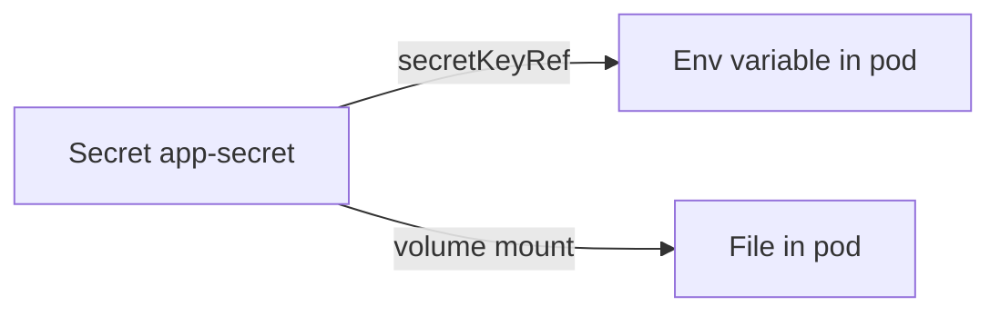
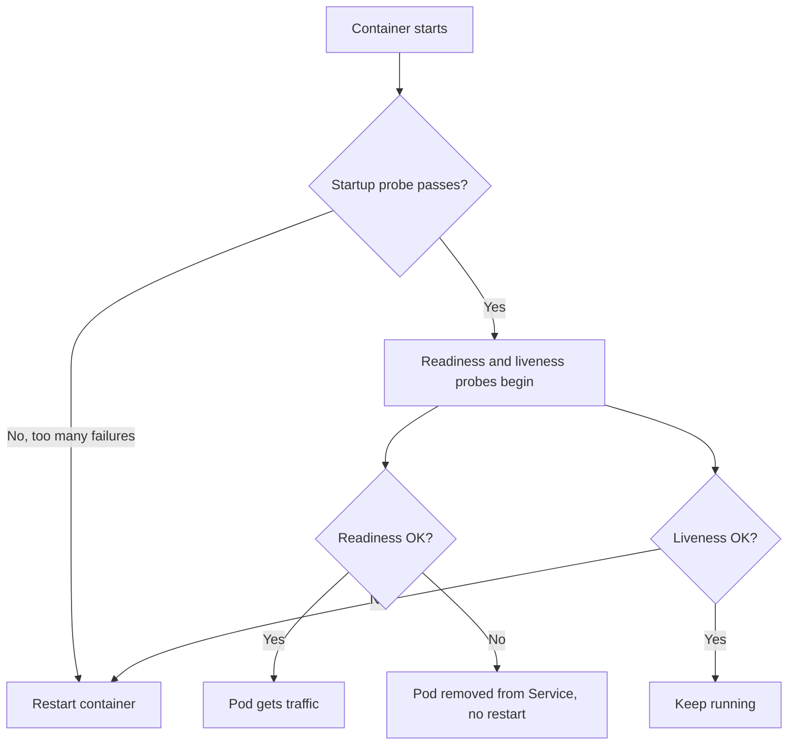
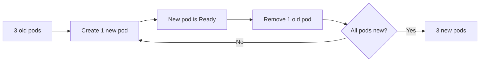
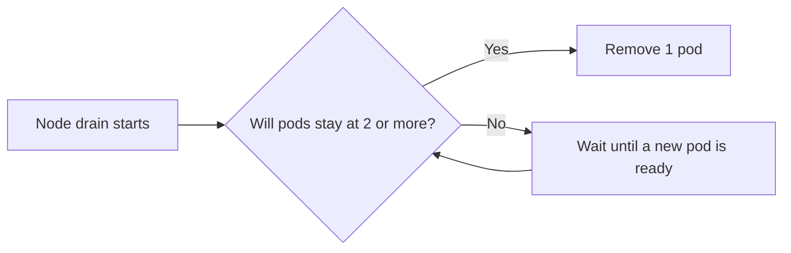
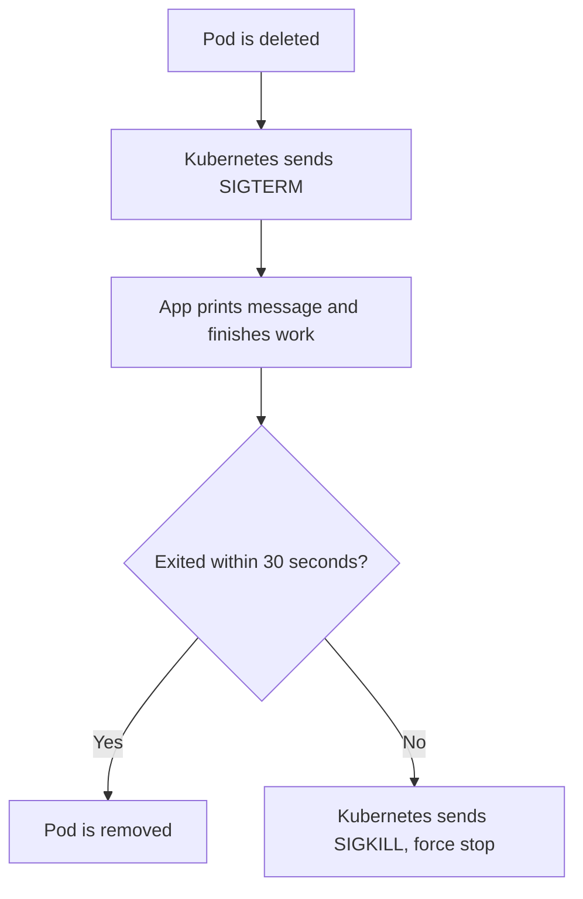

# Part 2: Config and Health

All files in this folder run in the namespace `production-labs` on minikube.

This part covers three things:

1. **Config**: giving settings and passwords to an app (ConfigMap, Secret, env variables)
2. **Health**: letting Kubernetes check if the app is healthy (startup, readiness, liveness probes)
3. **Safe updates**: changing or removing pods without downtime (rolling update, PDB, graceful shutdown)



## Before you start

Run all commands from this folder. Make sure minikube is running and the namespace exists:

```
minikube status
kubectl get namespace production-labs
```

If the namespace is missing, create it:

```
kubectl create namespace production-labs
```

---

## 1. ConfigMap

**Simple definition:** a ConfigMap keeps normal settings (like `APP_ENV=development`) outside the image. We can change settings without building the image again. Never keep passwords in it.

A pod can use a ConfigMap in two ways:



| File | What it does |
|---|---|
| `configmap.yaml` | Creates the ConfigMap `app-config` with `APP_ENV`, `LOG_LEVEL`, `APP_COLOR` |
| `configmap-pod.yaml` | Pod `configmap-demo` loads all keys as env variables using `envFrom` |
| `configmap-volume-pod.yaml` | Pod `configmap-volume-demo` mounts the ConfigMap at `/etc/app-config`, one file per key |
| `app-file-config.yaml` | ConfigMap `app-file-config` with one key `app.properties` that holds a whole file |
| `config-volume-demo.yaml` | Pod `config-volume-demo` mounts `app-file-config` at `/etc/myapp` as a read-only file |

**Points to remember**

- `volumes` brings the ConfigMap into the pod. `volumeMounts` places it at a folder inside the container. The `name` in both must match.
- Env variables are read only when the pod starts. After changing the ConfigMap, restart the pods.
- Files from a volume update by themselves after a short time, with no restart.
- The pod and the ConfigMap must be in the same namespace.

### Run and check: ConfigMap as env variables

```
kubectl apply -f configmap.yaml
kubectl get configmap app-config -n production-labs
kubectl describe configmap app-config -n production-labs

kubectl apply -f configmap-pod.yaml
kubectl get pod configmap-demo -n production-labs
kubectl exec -n production-labs configmap-demo -- printenv APP_ENV
kubectl exec -n production-labs configmap-demo -- env | grep -E "APP_|LOG_"
```

Expected: the pod is `Running`, and `printenv APP_ENV` prints `development`.

### Run and check: ConfigMap as files

```
kubectl apply -f configmap-volume-pod.yaml
kubectl get pod configmap-volume-demo -n production-labs
kubectl exec -n production-labs configmap-volume-demo -- ls /etc/app-config
kubectl exec -n production-labs configmap-volume-demo -- cat /etc/app-config/APP_ENV
```

Expected: three files (`APP_ENV`, `APP_COLOR`, `LOG_LEVEL`), and the content of `APP_ENV` is `development`.

### Run and check: a whole config file in a ConfigMap

```
kubectl apply -f app-file-config.yaml
kubectl apply -f config-volume-demo.yaml
kubectl get pod config-volume-demo -n production-labs
kubectl exec -n production-labs config-volume-demo -- ls /etc/myapp
kubectl exec -n production-labs config-volume-demo -- cat /etc/myapp/app.properties
```

Expected: one file `app.properties` with 3 lines inside.

Check that the mount is read-only (this command should fail with a "read-only file system" error):

```
kubectl exec -n production-labs config-volume-demo -- sh -c 'echo hi > /etc/myapp/app.properties'
```

---

## 2. Secret

**Simple definition:** a Secret is like a ConfigMap, but for sensitive values such as usernames and passwords. It is used in the same two ways: as env variables or as files.

| File | What it does |
|---|---|
| `secret.yaml` | Creates the Secret `app-secret` (type `Opaque`) with `DB_USERNAME` and `DB_PASSWORD` |
| `secret-pod.yaml` | Pod `secret-demo` takes each value with `secretKeyRef` as an env variable |
| `secret-volume-pod.yaml` | Pod `secret-volume-demo` mounts the Secret at `/etc/app-secret` as read-only files |



**Points to remember**

- `Opaque` is the normal type for general key-value data.
- `stringData` lets us write plain text. Kubernetes saves it as base64.
- base64 is **not** encryption. Anyone who can read the Secret can decode it.
- The password in `secret.yaml` is only a demo value. Never push a real password to GitHub.
- In a Secret volume the field is `secretName`. In a ConfigMap volume it is `name`.

### Run and check: create the Secret

```
kubectl apply -f secret.yaml
kubectl get secret app-secret -n production-labs
kubectl get secret app-secret -n production-labs -o yaml
```

Expected: under `data:` the values look like strange text (base64). Decode one to see that it is not encrypted:

```
kubectl get secret app-secret -n production-labs -o jsonpath='{.data.DB_USERNAME}' | base64 -d; echo
```

### Run and check: Secret as env variables

```
kubectl apply -f secret-pod.yaml
kubectl get pod secret-demo -n production-labs
kubectl exec -n production-labs secret-demo -- printenv DB_USERNAME
kubectl exec -n production-labs secret-demo -- printenv DB_PASSWORD
```

Expected: the plain values, `appuser` and the demo password.

### Run and check: Secret as files

```
kubectl apply -f secret-volume-pod.yaml
kubectl get pod secret-volume-demo -n production-labs
kubectl exec -n production-labs secret-volume-demo -- ls /etc/app-secret
kubectl exec -n production-labs secret-volume-demo -- cat /etc/app-secret/DB_USERNAME
```

Expected: two files (`DB_USERNAME`, `DB_PASSWORD`), each holding the plain value.

---

## 3. Environment variables (direct)

**Simple definition:** we write the value directly in the pod file with `value:`.

| File | What it does |
|---|---|
| `env-pod.yaml` | Pod `env-demo` sets `APP_NAME`, `APP_ENV`, `LOG_LEVEL` directly |

| Way | Where the value comes from |
|---|---|
| `value: development` | Written in the pod file |
| `configMapRef` | ConfigMap |
| `secretKeyRef` | Secret |

Use a direct value for a small setting of one pod. Use a ConfigMap for shared settings. Use a Secret for passwords. Env variables cannot be edited in a running pod: delete the pod and create it again.

### Run and check

```
kubectl apply -f env-pod.yaml
kubectl get pod env-demo -n production-labs
kubectl exec -n production-labs env-demo -- printenv APP_NAME
kubectl exec -n production-labs env-demo -- env | grep -E "APP_|LOG_"
```

Expected: `APP_NAME` prints `my-kubernetes-app`.

---

## 4. Probes (health checks)

**Simple definition:** a probe is a check that Kubernetes runs on a container. We have three kinds, and each one has a different job.

| Probe | Question it asks | If it fails |
|---|---|---|
| Startup | Has the app finished starting? | Container is restarted |
| Readiness | Is the app ready for traffic now? | Pod stops getting traffic, **no restart** |
| Liveness | Is the app still alive? | Container is restarted |



| File | What it does |
|---|---|
| `startup-probe.yaml` | Checks `/` on port 80 every 5 seconds, allows 12 failures (60 seconds to start) |
| `readiness-probe.yaml` | Checks `/` on port 80, waits 5 seconds first, 3 failures mean not ready |
| `liveness-probe.yaml` | Checks `/` on port 80, 3 failures mean the container is restarted |
| `wrong-readiness-probe.yaml` | Readiness probe with the wrong path `/wrong`, so the pod stays `0/1` |

**What the probe settings mean**

- `httpGet`: send an HTTP GET request. Codes 200 to 399 mean success.
- `initialDelaySeconds`: wait this long before the first check.
- `periodSeconds`: how often to check.
- `failureThreshold`: how many failures in a row before action is taken.

A running pod cannot have its probe edited. Delete the pod, fix the file, and apply it again.

### Run and check: startup probe

```
kubectl apply -f startup-probe.yaml
kubectl get pod startup-probe-demo -n production-labs
kubectl describe pod startup-probe-demo -n production-labs | grep -i "startup"
```

Expected: the pod becomes `1/1 Running`, and the describe output shows the startup probe settings.

### Run and check: readiness probe

```
kubectl apply -f readiness-probe.yaml
kubectl get pod readiness-probe-demo -n production-labs
```

Expected: `1/1`. Now break the home page, and watch the pod become not ready (open the watch in one terminal, run the `rm` in another):

```
kubectl get pods -n production-labs -w
kubectl exec -n production-labs readiness-probe-demo -- rm /usr/share/nginx/html/index.html
kubectl exec -n production-labs readiness-probe-demo -- curl -s -o /dev/null -w "%{http_code}\n" http://127.0.0.1:80/
```

Expected: after about 15 seconds the pod shows `0/1`, RESTARTS stays `0`, and curl prints `403`.

Put the page back to make the pod ready again:

```
kubectl exec -n production-labs readiness-probe-demo -- sh -c 'echo ok > /usr/share/nginx/html/index.html'
kubectl get pod readiness-probe-demo -n production-labs
```

### Run and check: liveness probe

```
kubectl apply -f liveness-probe.yaml
kubectl get pod liveness-probe-demo -n production-labs
```

Expected: `1/1` with RESTARTS `0`. Now break the home page, and watch the container restart:

```
kubectl get pods -n production-labs -w
kubectl exec -n production-labs liveness-probe-demo -- rm /usr/share/nginx/html/index.html
```

Expected: after about 15 seconds RESTARTS changes to `1`. The new container is a fresh copy, so the page is back. See the reason:

```
kubectl describe pod liveness-probe-demo -n production-labs | tail -15
```

To test with a wrong path instead, change `path: /` to `path: /wrong` in the file, then:

```
kubectl delete pod liveness-probe-demo -n production-labs
kubectl apply -f liveness-probe.yaml
kubectl get pods -n production-labs -w
```

Expected: RESTARTS keeps going up, and later the status may become `CrashLoopBackOff`.

### Run and check: wrong readiness probe

```
kubectl apply -f wrong-readiness-probe.yaml
kubectl get pod wrong-readiness-demo -n production-labs
kubectl describe pod wrong-readiness-demo -n production-labs | tail -10
```

Expected: the pod stays `0/1`, RESTARTS stays `0`, and the events show `Readiness probe failed: HTTP probe failed with statuscode: 404`.

To fix it, change `path: /wrong` to `path: /` and create the pod again:

```
kubectl delete pod wrong-readiness-demo -n production-labs
kubectl apply -f wrong-readiness-probe.yaml
kubectl get pod wrong-readiness-demo -n production-labs
```

Expected: `1/1`.

---

## 5. Rolling update

**Simple definition:** a rolling update replaces old pods with new pods a few at a time, so the app never goes down.

| File | What it does |
|---|---|
| `rolling-update.yaml` | Deployment `rolling-update-demo` with 3 replicas, `maxSurge: 1`, `maxUnavailable: 0` |

- `maxSurge: 1`: one extra pod is allowed during the update (4 pods at most).
- `maxUnavailable: 0`: there must always be 3 working pods.



Each revision is an old ReplicaSet that Kubernetes keeps. This is what makes a rollback possible.

### Run and check

```
kubectl apply -f rolling-update.yaml
kubectl get deployment rolling-update-demo -n production-labs
kubectl get pods -n production-labs -l app=rolling-update-demo
```

Expected: `3/3` ready. Now update the image, and watch (use two terminals):

```
kubectl get pods -n production-labs -l app=rolling-update-demo -w
kubectl set image deployment/rolling-update-demo nginx=nginx:1.28 -n production-labs
kubectl rollout status deployment/rolling-update-demo -n production-labs
```

Expected: a new pod appears first (4 pods), then an old one terminates, step by step, until all 3 are new.

See the history and the ReplicaSets:

```
kubectl rollout history deployment/rolling-update-demo -n production-labs
kubectl rollout history deployment/rolling-update-demo -n production-labs --revision=2
kubectl get rs -n production-labs
```

Go back to the previous version:

```
kubectl rollout undo deployment/rolling-update-demo -n production-labs
kubectl rollout status deployment/rolling-update-demo -n production-labs
```

---

## 6. PodDisruptionBudget (PDB)

**Simple definition:** a PDB tells Kubernetes the minimum number of pods that must stay running during **planned** removals, such as draining a node.

| File | What it does |
|---|---|
| `pdb.yaml` | PDB `rolling-update-pdb` with `minAvailable: 2` for pods labelled `app: rolling-update-demo` |

With 3 pods and `minAvailable: 2`, only 1 pod can be removed at a time.



A PDB does not stop crashes, and it does not stop `kubectl delete pod`. It protects only against planned removals.

### Run and check

The PDB protects the pods of `rolling-update-demo`, so apply that first.

```
kubectl apply -f rolling-update.yaml
kubectl apply -f pdb.yaml
kubectl get pdb -n production-labs
kubectl describe pdb rolling-update-pdb -n production-labs
```

Expected: `MIN AVAILABLE` is `2` and `ALLOWED DISRUPTIONS` is `1`.

---

## 7. Graceful shutdown

**Simple definition:** when a pod is deleted, Kubernetes first asks the app to stop nicely, so it can finish its work. Only if the app is too slow, Kubernetes stops it by force.

| File | What it does |
|---|---|
| `graceful-shutdown.yaml` | Pod `graceful-shutdown-demo` with `terminationGracePeriodSeconds: 30` and a `trap` for SIGTERM |



- `terminationGracePeriodSeconds: 30` is the **maximum** time allowed to shut down, not a delay.
- In our demo the container prints the message at once, waits 5 seconds, and exits. The pod is gone in about 5 seconds.

### Run and check

```
kubectl apply -f graceful-shutdown.yaml
kubectl get pod graceful-shutdown-demo -n production-labs
```

Open a second terminal and follow the logs:

```
kubectl logs -f graceful-shutdown-demo -n production-labs
```

In the first terminal, delete the pod and measure the time:

```
time kubectl delete pod graceful-shutdown-demo -n production-labs
```

Expected: the log shows `SIGTERM received; shutting down gracefully` right away, and the delete command takes about 5 seconds.

---

## Clean up

Delete everything created in this part:

```
kubectl delete -f . --ignore-not-found
```

Check that nothing is left:

```
kubectl get all,configmap,secret,pdb -n production-labs
```
